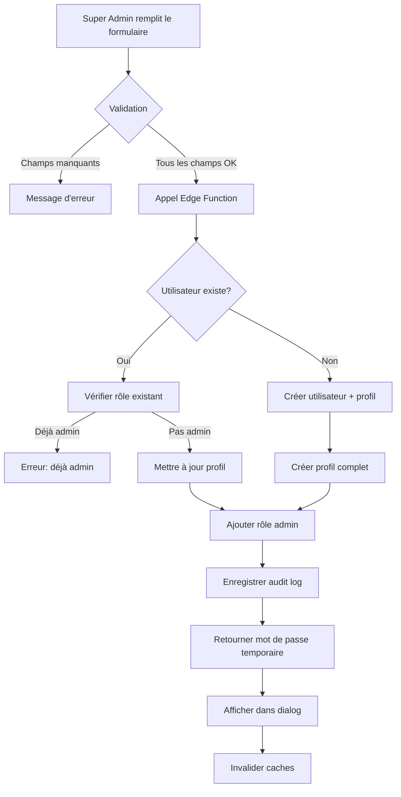

# Configuration des Comptes Administrateurs

## Problème Résolu

Les comptes administrateurs apparaissaient incorrectement dans la liste des patients, causant une confusion dans la gestion des utilisateurs.

## Modifications Apportées

### 1. Filtrage des Administrateurs de la Liste des Patients

**Fichier:** `src/components/admin/UsersManagementSection.tsx`

- Ajout d'une requête pour récupérer tous les utilisateurs avec un rôle admin
- Filtrage des profils pour exclure les administrateurs de la liste des patients
- Les administrateurs ne s'affichent plus dans l'onglet "Patients"

```typescript
// Récupérer les IDs des utilisateurs avec un rôle admin
const { data: adminRoles } = await supabase
  .from('user_roles')
  .select('user_id');

const adminUserIds = new Set(adminRoles?.map(r => r.user_id) || []);

// Filtrer les profils pour exclure les admins
return allProfiles.filter(profile => !adminUserIds.has(profile.id));
```

### 2. Amélioration du Formulaire de Création d'Admin

**Fichier:** `src/components/admin/AdminManagement.tsx`

Ajout des champs complets pour la création d'un compte administrateur :

- **Nom complet** (obligatoire) : Pour identifier clairement l'administrateur
- **Email** (obligatoire) : Pour la connexion et les notifications
- **Téléphone** (optionnel) : Pour un contact direct si nécessaire
- **Rôle** (obligatoire) : Définit les permissions de l'administrateur

**Nouveaux états ajoutés :**
```typescript
const [fullName, setFullName] = useState("");
const [phone, setPhone] = useState("");
```

**Validation renforcée :**
```typescript
if (!email || !selectedRole || !fullName) {
  toast({ 
    title: "Erreur", 
    description: "Email, nom complet et rôle requis",
    variant: "destructive" 
  });
  return;
}
```

### 3. Mise à Jour de l'Edge Function

**Fichier:** `supabase/functions/admin-management/index.ts`

**Interface mise à jour :**
```typescript
interface CreateAdminRequest {
  email: string;
  role: 'super_admin' | 'ops' | 'finance' | 'compliance' | 'support' | 'analyst';
  fullName: string;  // Maintenant obligatoire
  phone?: string;    // Optionnel
}
```

**Création de profil complet :**
```typescript
const { error: profileError } = await supabaseAdmin
  .from('profiles')
  .insert({
    id: userId,
    full_name: fullName,
    phone: phone || null,
  });
```

**Mise à jour du profil existant :**
Si l'utilisateur existe déjà, son profil est mis à jour avec les nouvelles informations :
```typescript
const { error: updateProfileError } = await supabaseAdmin
  .from('profiles')
  .update({
    full_name: fullName,
    phone: phone || null,
  })
  .eq('id', userId);
```

## Bénéfices

### Séparation Claire des Rôles
- Les administrateurs ne s'affichent plus avec les patients
- Liste des patients propre et précise
- Gestion distincte pour chaque type d'utilisateur

### Informations Complètes
- Tous les champs du profil sont renseignés dès la création
- Traçabilité améliorée des administrateurs
- Contact facilité en cas de besoin

### Invalidation du Cache
- Invalidation automatique des requêtes `admin-profiles` après création
- Mise à jour immédiate de l'interface

## Flux de Création d'un Admin



## Tables Impactées

### `profiles`
- Rempli avec nom complet et téléphone lors de la création d'admin
- Mis à jour si l'utilisateur existe déjà

### `user_roles`
- Contient tous les rôles administrateurs
- Utilisé pour filtrer les admins de la liste des patients

### `admin_audit_logs`
- Enregistre toutes les actions de gestion des admins
- Traçabilité complète

## Sécurité

- Seuls les `super_admin` peuvent créer d'autres administrateurs
- Vérification du rôle de l'appelant avant toute action
- Validation des champs obligatoires côté frontend et backend
- Mot de passe temporaire généré de manière sécurisée

## Tests Recommandés

### Test 1: Création d'Admin
1. Se connecter en tant que super_admin
2. Remplir tous les champs du formulaire
3. Vérifier que l'admin est créé avec toutes les informations
4. Vérifier qu'il n'apparaît pas dans la liste des patients

### Test 2: Validation des Champs
1. Essayer de créer un admin sans nom complet → Erreur
2. Essayer de créer un admin sans email → Erreur
3. Essayer de créer un admin sans rôle → Erreur
4. Créer avec téléphone vide → OK (optionnel)

### Test 3: Utilisateur Existant
1. Créer un patient normal
2. Essayer de lui donner un rôle admin avec le formulaire
3. Vérifier que son profil est mis à jour
4. Vérifier qu'il n'apparaît plus dans les patients

### Test 4: Filtrage
1. Créer plusieurs admins
2. Créer plusieurs patients
3. Vérifier que l'onglet "Patients" ne montre que les patients
4. Vérifier que l'onglet "Administrateurs" montre tous les admins

## Points d'Attention

- Le téléphone est optionnel mais recommandé
- Le nom complet est obligatoire pour une identification claire
- Les admins ne peuvent pas se désactiver eux-mêmes
- Le mot de passe temporaire doit être partagé immédiatement
