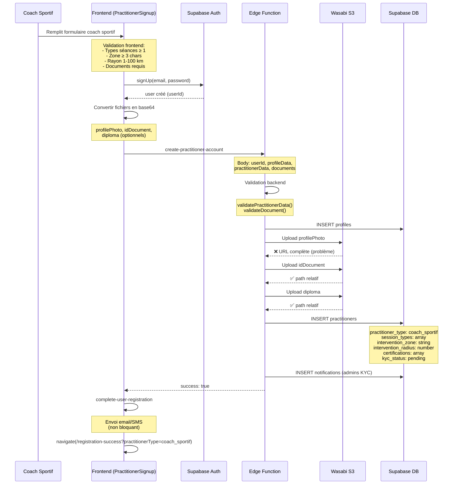

# Analyse du workflow d'inscription Coach Sportif

## Statut : ✅ Fonctionnel avec corrections mineures nécessaires

Date: 22 novembre 2025

## Résumé exécutif

Le workflow d'inscription des coachs sportifs **fonctionne correctement** comme le prouve l'inscription récente dans la base de données. Cependant, **une incohérence critique** a été identifiée dans le stockage des URLs de documents qui pourrait causer des problèmes d'affichage.

## Test réel - Dernière inscription

```sql
Coach sportif inscrit le 2025-11-22 13:08:14
- ID: 8847983d-f013-4da4-aa09-afe423c4f289
- Nom: ulrich praticien
- Phone: +22996466777
- Type: coach_sportif
- KYC Status: pending
- Documents uploadés:
  ✅ Photo de profil (URL complète Wasabi)
  ✅ Pièce d'identité (chemin relatif)
  ✅ Diplôme (chemin relatif)
  ✅ Autorisation d'exercice: NULL (non requis pour coach)
```

## 🔴 PROBLÈME CRITIQUE IDENTIFIÉ

### Incohérence de stockage des URLs de documents

**Problème :**
- `image` (photo de profil) : Stockée en **URL complète Wasabi**
  ```
  https://s3.eu-west-2.wasabisys.com/domicares/practitioner-documents/...
  ```

- Autres documents : Stockés en **chemin relatif**
  ```
  practitioner-documents/fd5c0be8-ffc8-4d02-90c6-679c373da899/1763816893343-idDocument.pdf
  ```

**Impact :**
- ⚠️ Confusion dans `getSignedFileUrl()` qui traite différemment les URLs complètes vs chemins relatifs
- ⚠️ Risque d'erreur d'affichage dans l'admin et le dashboard praticien
- ⚠️ Incohérence de l'architecture de stockage

**Localisation dans le code :**
```typescript
// supabase/functions/create-practitioner-account/index.ts (ligne 268)
const practitionerPayload = {
  ...practitionerData,
  image: uploadedDocs.profilePhoto?.url || null,              // ❌ URL complète
  id_document_url: uploadedDocs.idDocument?.path || null,     // ✅ Chemin relatif
  license_document_url: uploadedDocs.licenseDocument?.path || null, // ✅ Chemin
  insurance_document_url: uploadedDocs.diploma?.path || null, // ✅ Chemin
};
```

**Solution requise :**
```typescript
// Uniformiser : utiliser TOUJOURS le chemin relatif
const practitionerPayload = {
  ...practitionerData,
  image: uploadedDocs.profilePhoto?.path || null,             // ✅ Chemin relatif
  id_document_url: uploadedDocs.idDocument?.path || null,
  license_document_url: uploadedDocs.licenseDocument?.path || null,
  insurance_document_url: uploadedDocs.diploma?.path || null,
};
```

## Validation du formulaire (Frontend)

### ✅ Champs Coach Sportif correctement validés

**Champs généraux requis :**
- Prénom, Nom ✅
- Date de naissance ✅
- Sexe ✅
- Adresse ✅
- Téléphone ✅
- Email ✅
- Mot de passe (min 8 caractères) ✅
- Profession: "Coach sportif" ✅
- Années d'expérience ✅

**Champs spécifiques coach sportif :**
- Types de séances (au moins 1) ✅
  ```typescript
  if (formData.sessionTypes.length === 0) 
    errors.sessionTypes = "Au moins un type de séance requis";
  ```

- Zone d'intervention (min 3 caractères) ✅
  ```typescript
  if (formData.interventionZone.trim().length < 3) 
    errors.interventionZone = "Zone d'intervention trop courte (min 3 caractères)";
  ```

- Rayon d'intervention (1-100 km) ✅
  ```typescript
  const radius = parseInt(formData.interventionRadius);
  if (isNaN(radius) || radius < 1 || radius > 100) 
    errors.interventionRadius = "Rayon entre 1 et 100 km";
  ```

**Documents requis :**
- Photo de profil : Optionnel ✅
- Pièce d'identité : **OBLIGATOIRE** ✅
- Diplôme/Certificat : Optionnel ✅
- Autorisation d'exercice : **Non affiché** pour coach sportif ✅

## Validation Backend

### ✅ Edge function `create-practitioner-account`

**Validation des données practitioner :**
```typescript
function validatePractitionerData(practitionerData: any): string[] {
  const errors: string[] = [];
  
  // Nom
  if (!practitionerData.name || practitionerData.name.trim().length < 2) {
    errors.push('Nom invalide (minimum 2 caractères)');
  }
  
  // Téléphone
  if (!practitionerData.phone || !/^\+?[0-9]{8,15}$/.test(...)) {
    errors.push('Numéro de téléphone invalide');
  }
  
  // Spécialité non requise pour coach
  const isCoachSportif = practitionerData.practitioner_type === 'coach_sportif';
  if (!isCoachSportif && !practitionerData.specialty) {
    errors.push('Spécialité requise');
  }
  
  // Années d'expérience
  if (practitionerData.years_experience !== null && 
      (practitionerData.years_experience < 0 || practitionerData.years_experience > 70)) {
    errors.push('Années d\'expérience invalides (0-70)');
  }
  
  // Rayon d'intervention
  if (practitionerData.intervention_radius && 
      (practitionerData.intervention_radius < 1 || practitionerData.intervention_radius > 100)) {
    errors.push('Rayon d\'intervention invalide (1-100 km)');
  }
  
  return errors;
}
```

**Validation des documents :**
- Format base64 ✅
- Types autorisés : PDF, JPG, PNG ✅
- Taille max : 5MB ✅

## Workflow complet - Coach Sportif



## Mapping des données Coach Sportif

### Frontend → Backend

```typescript
// PractitionerSignup.tsx (lignes 308-326)
const practitionerData = {
  user_id: userId,
  name: `${firstName} ${lastName}`,
  phone: formData.phone,
  address: formData.address,
  specialty: formData.profession,                    // "Coach sportif"
  practitioner_type: "coach_sportif",               // Mapping via professionToType
  years_experience: parseInt(formData.experience),
  kyc_status: "pending",
  can_accept_missions: false,
  bio: `Profession: ${formData.profession}\nStructure: ${formData.currentWorkplace}`,
  license_number: formData.registrationNumber,
  
  // Champs spécifiques coach sportif
  session_types: formData.sessionTypes,             // ["individuelle", "duo", "groupe"]
  intervention_zone: formData.interventionZone,     // "Cotonou"
  intervention_radius: parseInt(formData.interventionRadius), // 15
  certifications: formData.certifications
    ? formData.certifications.split(",").map(cert => cert.trim()).filter(Boolean)
    : null
};
```

### Documents Coach Sportif

| Document | Champ BD | Requis | Utilisation |
|----------|----------|--------|-------------|
| Photo profil | `image` | Non | Avatar public |
| Pièce identité | `id_document_url` | **OUI** | Vérification identité KYC |
| Diplôme/Certificat | `insurance_document_url` | Non | Validation qualifications |
| Autorisation exercice | `license_document_url` | **NON** | N/A pour coach sportif |

**Note importante :** Pour les coachs sportifs, le diplôme/certificat est stocké dans `insurance_document_url` (normalement pour assurance) car ils n'ont pas besoin d'autorisation d'exercice médicale.

## Points de friction potentiels

### 1. ⚠️ Message d'erreur générique

**Problème actuel :**
```typescript
if (createError || !createResult?.success) {
  const errorMessage = createError?.message || createResult?.error || "Échec de création du compte";
  // ...
  throw new Error(userMessage);
}
```

**Amélioration suggérée :**
- Ajouter des logs plus détaillés côté edge function
- Différencier les erreurs de validation, d'upload, de création DB
- Retourner un code d'erreur structuré

### 2. ⚠️ Perte de données en cas d'erreur

**Problème :** Si l'upload échoue après avoir rempli tout le formulaire, l'utilisateur perd ses données.

**Solution suggérée :**
- Ajouter `localStorage` pour sauvegarder temporairement le formulaire
- Restaurer les données au rechargement de la page
- Clear après succès

### 3. ✅ Gestion du rollback

Le rollback est correctement implémenté dans l'edge function :
```typescript
catch (error: any) {
  // Rollback: Supprimer le profil si créé
  if (profileCreated) {
    await supabase.from('profiles').delete().eq('id', userId);
  }
  // TODO: Supprimer documents Wasabi
}
```

**Note :** La suppression des documents Wasabi n'est pas implémentée (TODO).

## Dashboard Coach Sportif

### Redirection après inscription

✅ **Correctement implémentée** (correction récente) :

```typescript
// PractitionerSignup.tsx (ligne 400)
navigate(`/registration-success?type=practitioner&practitionerType=${practitionerType}`, { replace: true });

// RegistrationSuccess.tsx
const practitionerType = searchParams.get('practitionerType');
const dashboardPath = practitionerType === 'coach_sportif' 
  ? '/dashboard/coach' 
  : '/dashboard/practitioner';
```

### Dashboard Coach vs Praticien classique

| Feature | Coach Sportif | Praticien médical |
|---------|---------------|-------------------|
| Route | `/dashboard/coach` | `/dashboard/practitioner` |
| Créer séances groupe | ✅ Oui | ❌ Non |
| Accepter consultations médicales | ❌ Non | ✅ Oui |
| Afficher types séances | ✅ Oui | ❌ Non |
| Afficher zone intervention | ✅ Oui | ❌ Non |
| Documents KYC | Photo + ID + Diplôme | Photo + ID + Licence + Diplôme |

## Tests recommandés

### Test 1 : Inscription complète coach sportif

**Données de test :**
```
Prénom: Jean
Nom: Dupont
Email: coach.test@example.com
Téléphone: +22996123456
Profession: Coach sportif
Années expérience: 5

Types séances: ☑ individuelle ☑ duo ☑ groupe
Zone intervention: Cotonou
Rayon intervention: 15 km
Certifications: Certificat coaching sportif, Nutrition sportive

Documents:
- Photo profil (JPG < 5MB)
- Pièce identité (PDF < 5MB)
- Diplôme (PDF < 5MB)
```

**Résultats attendus :**
1. ✅ Compte auth créé
2. ✅ Profil créé
3. ✅ Documents uploadés sur Wasabi
4. ✅ Entrée practitioners créée avec practitioner_type='coach_sportif'
5. ✅ Notification KYC envoyée aux admins
6. ✅ Email/SMS confirmation envoyé au coach
7. ✅ Redirection vers `/registration-success?practitionerType=coach_sportif`
8. ✅ Bouton "Accéder au dashboard" redirige vers `/dashboard/coach`

### Test 2 : Validation erreurs

**Scénarios d'erreur à tester :**
- ❌ Types séances non sélectionnés
- ❌ Zone intervention < 3 caractères
- ❌ Rayon intervention = 0 ou > 100
- ❌ Pièce identité non fournie
- ❌ Document > 5MB
- ❌ Format document non supporté (ex: .docx)
- ❌ Email déjà utilisé

### Test 3 : Workflow KYC complet

1. Coach s'inscrit → Status `pending`
2. Dashboard coach : Message "En attente de validation"
3. Admin voit le dossier dans la file KYC
4. Admin clique "Voir documents"
5. ⚠️ **Tester si tous les documents s'affichent correctement**
6. Admin approuve → Status `approved`
7. Coach reçoit email/SMS de validation
8. Dashboard coach : Peut créer des séances de groupe

## Corrections à appliquer

### 🔴 PRIORITÉ 1 : Uniformiser le stockage des URLs

**Fichier :** `supabase/functions/create-practitioner-account/index.ts`

**Ligne 268 :**
```typescript
// AVANT (incorrect)
image: uploadedDocs.profilePhoto?.url || null,

// APRÈS (correct)
image: uploadedDocs.profilePhoto?.path || null,
```

**Impact :** Critique pour l'affichage cohérent des documents

### 🟡 PRIORITÉ 2 : Améliorer les messages d'erreur

**Fichier :** `src/pages/PractitionerSignup.tsx`

**Lignes 357-371 :** Ajouter plus de contexte dans les erreurs

### 🟢 PRIORITÉ 3 : Implémenter la suppression Wasabi dans rollback

**Fichier :** `supabase/functions/create-practitioner-account/index.ts`

**Ligne 336 :** Créer edge function `delete-from-wasabi`

### 🟢 PRIORITÉ 4 : Sauvegarder formulaire dans localStorage

**Fichier :** `src/pages/PractitionerSignup.tsx`

Ajouter persistence temporaire du formulaire pour éviter perte de données

## Conclusion

Le workflow d'inscription des coachs sportifs **fonctionne** comme le prouve l'inscription récente dans la base de données. Les validations frontend et backend sont correctes.

**Seul problème critique identifié :**
- Incohérence de stockage de l'URL de la photo de profil (URL complète au lieu de chemin relatif)

Cette incohérence doit être corrigée pour garantir un affichage fiable des documents dans l'admin et le dashboard praticien.

**Recommandations :**
1. ✅ Appliquer la correction PRIORITÉ 1 immédiatement
2. ✅ Tester l'affichage des documents après correction
3. ✅ Valider le workflow KYC complet avec un coach de test
4. ✅ Implémenter les améliorations PRIORITÉ 2-4 progressivement
