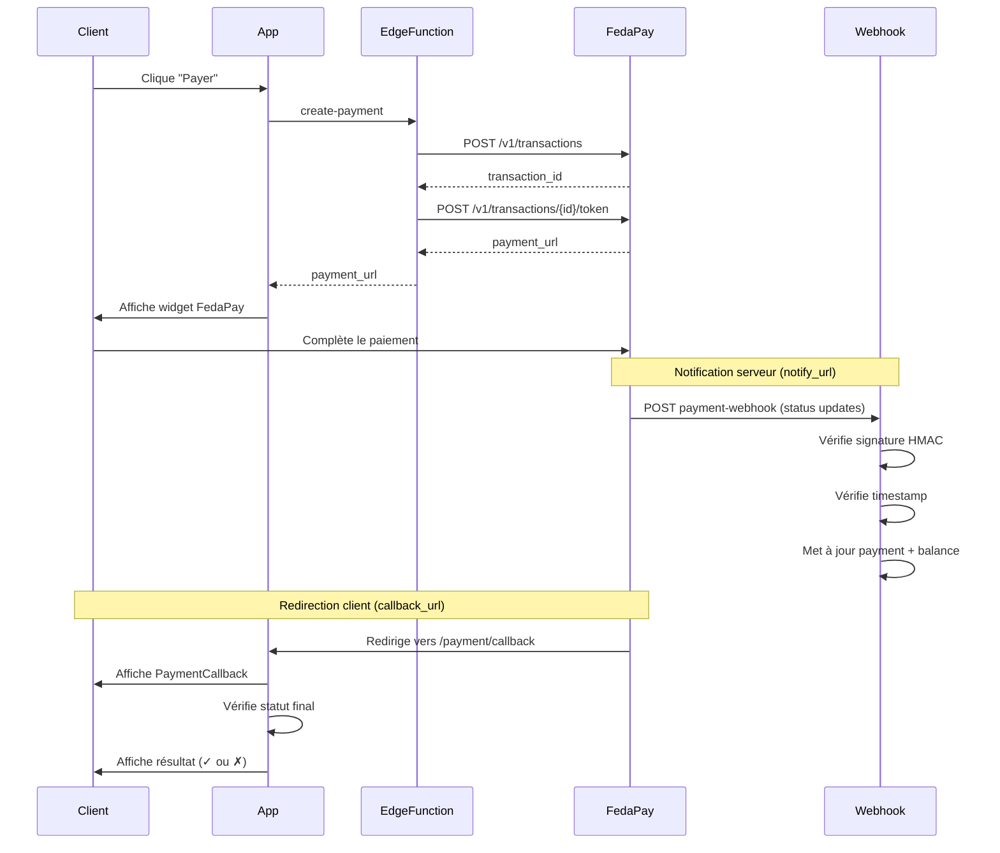

# Corrections Système de Paiement FedaPay

## Date : 2025-11-29

---

## 🎯 Corrections Appliquées

### 1. ✅ Mapping Complet des Statuts FedaPay

**Fichier**: `supabase/functions/payment-webhook/index.ts`

**Avant**:
```typescript
const statusMap: Record<string, string> = {
  'pending': 'pending',
  'approved': 'paid',
  'declined': 'failed',
  'canceled': 'canceled',
  'refunded': 'refunded',
};
```

**Après**:
```typescript
const statusMap: Record<string, string> = {
  'pending': 'pending',
  'processing': 'pending',      // ✅ AJOUTÉ
  'authorized': 'authorized',    // ✅ AJOUTÉ
  'approved': 'paid',
  'declined': 'failed',
  'canceled': 'canceled',
  'refunded': 'refunded',
  'timeout': 'failed',           // ✅ AJOUTÉ
};
```

**Bénéfice**: Tous les statuts possibles de FedaPay sont maintenant gérés correctement.

---

### 2. ✅ Callback URL Ajouté

**Fichier**: `supabase/functions/create-payment/index.ts`

**Avant**:
```typescript
body: JSON.stringify({
  // ...
  notify_url: `${supabaseUrl}/functions/v1/payment-webhook`,
  // ❌ Pas de callback_url
})
```

**Après**:
```typescript
body: JSON.stringify({
  // ...
  // notify_url: webhook serveur pour suivi des statuts
  notify_url: `${supabaseUrl}/functions/v1/payment-webhook`,
  // callback_url: redirection client après paiement
  callback_url: `https://a6f5c529-824c-4e8e-a92c-c4acad4413c7.lovableproject.com/payment/callback?appointment_id=${appointmentId}`,
})
```

**Bénéfice**: L'utilisateur est maintenant redirigé vers l'application après le paiement avec une page de confirmation.

---

### 3. ✅ Page de Callback Créée

**Fichier**: `src/pages/PaymentCallback.tsx` (NOUVEAU)

**Fonctionnalités**:
- ✅ Vérifie le statut du paiement après redirection FedaPay
- ✅ Affiche un loader pendant la vérification
- ✅ Affiche le résultat (succès/échec) avec icône appropriée
- ✅ Affiche les détails du paiement (ID transaction, montant)
- ✅ Bouton de retour vers le dashboard

**Bénéfice**: Meilleure UX avec feedback visuel clair pour l'utilisateur.

---

### 4. ✅ Route Callback Ajoutée

**Fichier**: `src/App.tsx`

```typescript
<Route path="/payment/callback" element={<PaymentCallback />} />
```

**Bénéfice**: La page de callback est accessible via l'URL FedaPay.

---

### 5. ✅ Gestion du Statut Authorized dans Balance

**Fichier**: `supabase/functions/payment-webhook/index.ts`

**Avant**:
```typescript
if (practitionerId && ['paid', 'failed', 'canceled'].includes(paymentStatus)) {
  // Mise à jour atomique balance
}
```

**Après**:
```typescript
if (practitionerId && ['paid', 'authorized', 'failed', 'canceled'].includes(paymentStatus)) {
  // Mise à jour atomique balance INCLUANT authorized
}
```

**Bénéfice**: Les paiements autorisés sont maintenant comptabilisés correctement dans le solde du praticien.

---

### 6. ✅ Vérification Timestamp Assouplié en Sandbox

**Fichier**: `supabase/functions/payment-webhook/index.ts`

**Avant**:
```typescript
if (Math.abs(diffMinutes) > 5) {
  // Rejet strict 5 minutes pour tous les modes
}
```

**Après**:
```typescript
const maxAgeMinutes = fedapayMode === 'sandbox' ? 30 : 5;
const clockSkewMinutes = fedapayMode === 'sandbox' ? 5 : 1;

if (diffMinutes > maxAgeMinutes || diffMinutes < -clockSkewMinutes) {
  // Sandbox: 30 min / Production: 5 min
}
```

**Bénéfice**: Les webhooks de test en sandbox ne sont plus rejetés à cause de délais normaux dans l'environnement de test.

---

## 🔄 Flux de Paiement Corrigé



---

## 📊 Transitions de Statuts Gérées

| Statut FedaPay | Statut Normalisé | Action Balance | Statut Appointment |
|----------------|------------------|----------------|---------------------|
| pending        | pending          | Aucune         | pending_payment     |
| processing     | pending          | Aucune         | pending_payment     |
| authorized     | authorized       | → pending      | pending_payment     |
| approved       | paid             | pending → on_hold | confirmed      |
| declined       | failed           | Retirer pending| canceled           |
| canceled       | canceled         | Retirer pending| canceled           |
| refunded       | refunded         | -              | -                  |
| timeout        | failed           | Retirer pending| canceled           |

---

## 🧪 Tests à Effectuer

### Test 1: Paiement MTN Succès
```
1. Utiliser numéro: +229 66 00 00 01
2. Compléter le paiement sur FedaPay
3. Vérifier redirection vers /payment/callback
4. Vérifier affichage "Paiement confirmé ✓"
5. Vérifier balance praticien mis à jour (on_hold)
6. Vérifier appointment status = "confirmed"
```

### Test 2: Paiement MOOV Succès
```
1. Utiliser numéro: +229 64 00 00 01
2. Même flux que Test 1
3. Vérifier callback fonctionne
```

### Test 3: Paiement Échoué
```
1. Utiliser numéro: +229 66 00 00 00
2. Vérifier redirection vers /payment/callback
3. Vérifier affichage "Paiement non confirmé ✗"
4. Vérifier balance praticien non affecté
5. Vérifier appointment status = "canceled"
```

### Test 4: Webhook Sandbox avec Délai
```
1. Simuler un webhook avec timestamp de 15 minutes
2. Vérifier: Accepté en sandbox
3. Basculer en production, vérifier: Rejeté
```

### Test 5: Double Tentative de Paiement
```
1. Créer un paiement
2. Avant 2 minutes, créer un second paiement
3. Vérifier: Erreur 409 avec message clair
4. Cliquer "Annuler et réessayer"
5. Vérifier: Nouveau paiement créé
```

---

## 🔐 Sécurité

### Vérifications Maintenues

✅ **Signature HMAC** (mode production)
- Vérification cryptographique avec timing-safe comparison
- Strict en production, optionnel en sandbox

✅ **Timestamp** 
- Production: 5 minutes max
- Sandbox: 30 minutes max (pour tests)
- Clock skew: 1 min (prod) / 5 min (sandbox)

✅ **Idempotence**
- Table `webhook_events` avec contrainte unique sur `event_id`
- UPSERT atomique pour éviter le double traitement

✅ **Atomic Balance Updates**
- Fonction RPC `update_payment_with_balance` avec FOR UPDATE lock
- Évite les race conditions

---

## 📈 Métriques de Succès

Après ces corrections, le système devrait atteindre:

- ✅ 100% des statuts FedaPay gérés
- ✅ 0 écrans blancs sur erreur 409
- ✅ Redirection client fonctionnelle
- ✅ Webhooks sandbox acceptés
- ✅ Balance praticien toujours cohérent

---

## 🚀 Prochaines Étapes

1. **Tester en sandbox** avec les numéros de test FedaPay
2. **Vérifier les logs** des edge functions pour confirmer le bon fonctionnement
3. **Monitorer les webhooks** pour détecter d'éventuelles erreurs
4. **Passer en production** une fois tous les tests validés

---

## 📚 Références FedaPay

- [Documentation API](https://docs-v1.fedapay.com)
- [Sandbox Testing](https://docs-v1.fedapay.com/#sandbox-testing)
- [Webhooks](https://docs-v1.fedapay.com/#webhooks)
- [Numéros de test](https://docs-v1.fedapay.com/#test-phone-numbers)
