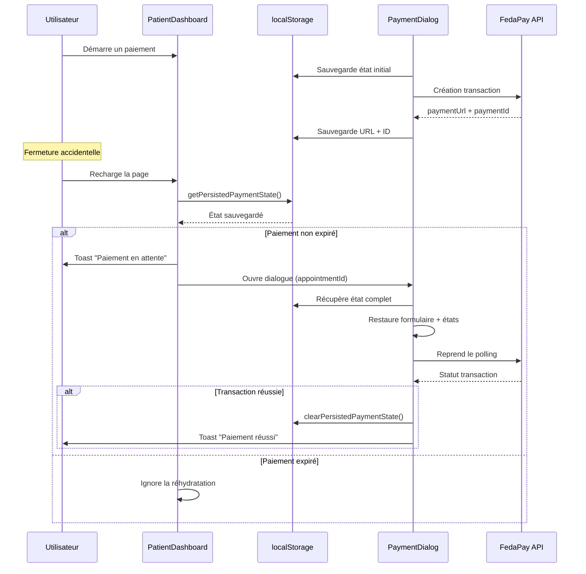

# Système de Réhydratation des Paiements

## Vue d'ensemble

Le système de réhydratation permet aux patients de reprendre un paiement en cours après un rechargement de page ou une fermeture accidentelle du navigateur. Cela améliore l'expérience utilisateur en évitant de perdre la progression d'un paiement.

## Fonctionnement

### 1. Persistance de l'état (localStorage)

L'état du paiement est automatiquement sauvegardé dans `localStorage` à chaque étape du processus :

**Fichier**: `src/lib/payment-storage.ts`

```typescript
interface PersistedPaymentState {
  appointmentId: string;
  amount: number;
  paymentMethod: 'mtn' | 'orange' | 'moov';
  phoneNumber: string;
  paymentStatus: 'idle' | 'pending' | 'success' | 'error';
  paymentUrl: string | null;
  paymentId: string | null;
  transactionId: string | null;
  expiresAt: string | null;
  useSavedMethod: boolean;
  selectedSavedMethod: string;
  lastUpdated: number; // timestamp
}
```

### 2. Détection au chargement (PatientDashboard)

**Fichier**: `src/pages/PatientDashboard.tsx` (lignes 46-73)

Au montage du composant, le système :
1. ✅ Vérifie s'il existe un paiement persisté
2. ✅ Vérifie que le statut est `pending`
3. ✅ Vérifie que le paiement n'est pas expiré (max 5 minutes)
4. ✅ Ouvre automatiquement le dialogue de paiement
5. ✅ Affiche un toast informatif à l'utilisateur

```typescript
useEffect(() => {
  const persisted = getPersistedPaymentState();

  if (persisted?.paymentStatus !== 'pending') {
    return;
  }

  // Vérifier expiration (5 minutes)
  const elapsed = Date.now() - persisted.lastUpdated;
  const MAX_AGE = 5 * 60 * 1000;

  if (elapsed > MAX_AGE) {
    console.log('⚠️ Paiement en attente expiré');
    return;
  }

  // Réhydrater
  setAppointmentIdForPayment(persisted.appointmentId);
  setPaymentAmount(persisted.amount);
  setPaymentDialogOpen(true);

  toast({
    title: '💳 Paiement en attente',
    description: 'Vous avez un paiement en cours...',
  });
}, []);
```

### 3. Restauration de l'état (PaymentDialog)

**Fichier**: `src/components/PaymentDialog.tsx` (lignes 452-489)

Quand le dialogue s'ouvre :
1. ✅ Vérifie si une réhydratation a déjà eu lieu (via `hasRehydratedRef`)
2. ✅ Récupère l'état persisté
3. ✅ Vérifie la correspondance de l'`appointmentId`
4. ✅ Restaure tous les états du formulaire
5. ✅ Relance le polling si le statut est `pending`
6. ✅ Affiche un toast de confirmation

### 4. Bannière d'alerte

**Fichier**: `src/pages/PatientDashboard.tsx` (lignes 331-350)

Une bannière orange s'affiche en haut du dashboard si des rendez-vous confirmés sont en attente de paiement :
- 🔶 Indicateur visuel avec icône
- 📊 Nombre de paiements en attente
- 🔘 Bouton "Payer maintenant" pour accès rapide

## Comportements clés

### ✅ Ce qui est sauvegardé automatiquement
- Méthode de paiement sélectionnée
- Numéro de téléphone
- URL de paiement FedaPay
- ID de transaction
- Date d'expiration
- Méthodes de paiement sauvegardées utilisées

### ✅ Sécurité
- ⏱️ **Expiration automatique** : 5 minutes max
- 🔐 **Pas de données sensibles** : Les numéros sont déjà chiffrés
- 🧹 **Nettoyage automatique** : État effacé après succès ou échec

### ✅ Experience utilisateur
1. **Rechargement accidentel** : Le paiement reprend automatiquement
2. **Fermeture du navigateur** : État restauré à la réouverture
3. **Changement d'onglet** : Polling continue en arrière-plan
4. **Notifications claires** : Toasts informatifs à chaque étape

## Cas limites gérés

### 🔴 Expiration du paiement
Si le paiement est trop ancien (>5 min), il n'est pas réhydraté :
```typescript
const elapsed = Date.now() - persisted.lastUpdated;
if (elapsed > MAX_AGE) {
  // Abandon de la réhydratation
  return;
}
```

### 🔴 Mauvais appointmentId
Si l'utilisateur ouvre un autre rendez-vous, l'ancien état est ignoré :
```typescript
if (persisted.appointmentId !== appointmentId) {
  return;
}
```

### 🔴 Double réhydratation
Un ref empêche les réhydratations multiples :
```typescript
const hasRehydratedRef = useRef(false);
if (hasRehydratedRef.current) return;
```

## Flux complet



## Tests recommandés

### Scénario 1 : Rechargement pendant le polling
1. Créer un rendez-vous
2. Lancer le paiement (statut: pending)
3. Recharger la page (F5)
4. ✅ Vérifier : dialogue ouvert, polling actif, états restaurés

### Scénario 2 : Fermeture puis réouverture
1. Créer un rendez-vous
2. Lancer le paiement
3. Fermer l'onglet
4. Rouvrir l'application
5. ✅ Vérifier : bannière + toast + dialogue automatique

### Scénario 3 : Expiration
1. Créer un paiement
2. Attendre 6 minutes
3. Recharger la page
4. ✅ Vérifier : pas de réhydratation

### Scénario 4 : Paiement complété
1. Créer un paiement
2. Le compléter (statut: success)
3. Recharger la page
4. ✅ Vérifier : pas de réhydratation, état nettoyé

## Améliorations futures possibles

1. **Historique des tentatives** : Tracker les échecs répétés
2. **Notification push** : Rappel après X minutes d'inactivité
3. **Reprise multi-appareils** : Sync via backend (nécessite auth token)
4. **Analytics** : Mesurer taux d'abandon vs réhydratation réussie
5. **Timeout configurable** : Adapter selon le provider (FedaPay)

## Logs de débogage

Le système log automatiquement :
- `🔄 Réhydratation d'un paiement en cours:` - Détection
- `⚠️ Paiement en attente expiré` - Abandon
- `🔄 Réhydratation du paiement:` - Restauration dans PaymentDialog

Vérifier la console pour diagnostiquer les problèmes.
