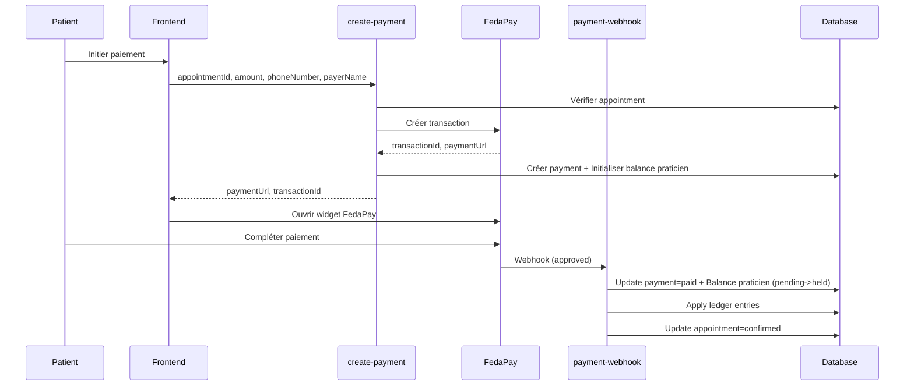
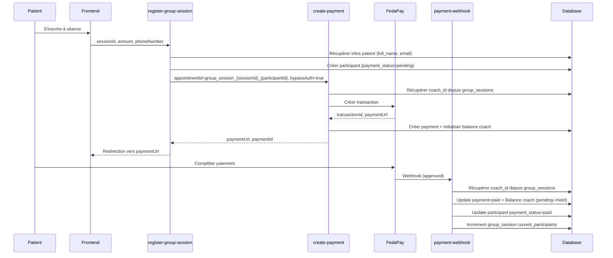

# Vérification et Corrections du Système de Paiement

## 🔍 Vérification effectuée le 2025-11-25

### ✅ Configuration FedaPay
- ✓ Secrets configurés: `FEDAPAY_PUBLIC_KEY`, `FEDAPAY_SECRET_KEY`, `FEDAPAY_WEBHOOK_SECRET`, `FEDAPAY_MODE`
- ✓ Script CDN FedaPay chargé dans `index.html`
- ✓ Types et utilitaires en place (`fedapay-widget.ts`, `payment-status.ts`, `fee-calculator.ts`)

---

## 🚨 Problèmes Critiques Corrigés

### 1. **Clé Publique FedaPay Non Disponible au Frontend**

#### ❌ Problème
Le composant `FedaPayWidget.tsx` utilisait `import.meta.env.VITE_FEDAPAY_PUBLIC_KEY` qui n'était pas définie, avec une valeur par défaut `pk_sandbox_default_key` non fonctionnelle.

#### ✅ Solution
- Créé nouvelle edge function `get-fedapay-config` qui expose la clé publique de manière sécurisée
- Modifié `FedaPayWidget.tsx` pour charger dynamiquement la configuration au démarrage
- Ajouté validation pour s'assurer que la config est chargée avant d'initier un paiement

---

### 2. **Paiements des Séances de Groupe NON Fonctionnels**

#### ❌ Problème
L'edge function `register-group-session` appelait `create-payment` sans fournir les champs requis `payerName` et `payerEmail`, causant une erreur de validation Zod.

#### ✅ Solution
- Modifié `register-group-session` pour récupérer les informations du patient (`full_name`, `email`)
- Ajouté `bypassAuth: true` et `patientId` pour utiliser le mode service role
- Passé toutes les données requises à `create-payment`

---

### 3. **Coaches Ne Recevaient JAMAIS Leurs Paiements**

#### ❌ Problème
**Critique!** Trois edge functions cherchaient le `practitioner_id` uniquement dans la table `appointments`:
- `create-payment/index.ts` (lignes 421-444)
- `payment-webhook/index.ts` (lignes 80-95)
- `release-held-funds/index.ts` (lignes 76-99)
- `apply-ledger-entries/index.ts` (lignes 23-37)

Pour les séances de groupe, l'`appointmentId` est au format `group_session_{sessionId}_{participantId}`, qui **n'existe pas** dans la table `appointments`.

**Résultat:** Les balances des coaches n'étaient jamais initialisées, les paiements n'étaient jamais crédités, et les fonds n'étaient jamais libérés.

#### ✅ Solution
Corrigé toutes les edge functions pour:
1. Détecter si `appointment_id.startsWith('group_session_')`
2. Si oui, extraire le `sessionId` et récupérer le `coach_id` depuis `group_sessions`
3. Si non, procéder normalement avec la table `appointments`

---

## 🎯 Flux Corrigé

### Rendez-vous Individuels (Médecins, Infirmiers, etc.)


### Séances de Groupe (Coachs Sportifs)


---

## 📊 Tables Impliquées

### `payments`
- Enregistre tous les paiements (rendez-vous + séances de groupe)
- `appointment_id` peut être:
  - Un UUID standard pour les rendez-vous classiques
  - Format `group_session_{sessionId}_{participantId}` pour les séances de groupe

### `practitioner_balances`
- Un enregistrement par praticien (médecins, infirmiers, **coachs**)
- `balance_pending`: Montant des paiements initiés
- `balance_on_hold`: Montant des paiements confirmés en période de hold
- `balance_available`: Montant disponible pour versement

### `group_session_participants`
- Enregistre les inscriptions aux séances de groupe
- `payment_status`: 'pending', 'paid', ou 'failed'
- Mis à jour par le webhook lors de la confirmation du paiement

### `group_sessions`
- `coach_id`: Référence vers `practitioners.id`
- `current_participants`: Incrémenté automatiquement via trigger quand `payment_status='paid'`

---

## 🧪 Tests à Effectuer

### Test 1: Paiement Rendez-vous Classique
1. Se connecter en tant que patient
2. Créer un rendez-vous avec un médecin/infirmier
3. Initier le paiement
4. Compléter le paiement via FedaPay
5. ✅ Vérifier que le praticien reçoit le montant net dans sa balance

### Test 2: Paiement Séance de Groupe (COACH)
1. Se connecter en tant que patient
2. S'inscrire à une séance de coach sportif
3. Compléter le paiement
4. ✅ Vérifier que:
   - Le participant est ajouté avec `payment_status='paid'`
   - Le coach reçoit le montant net dans sa balance
   - Le compteur `current_participants` est incrémenté

### Test 3: Libération des Fonds
1. Attendre la fin de la période de hold (2 jours par défaut)
2. Exécuter `release-held-funds` (ou attendre le cron automatique)
3. ✅ Vérifier que les fonds passent de `balance_on_hold` à `balance_available`

---

## 🔧 Commandes SQL de Vérification

```sql
-- Vérifier les balances des coachs
SELECT 
  p.name,
  p.practitioner_type,
  pb.balance_available,
  pb.balance_pending,
  pb.balance_on_hold,
  pb.currency
FROM practitioner_balances pb
JOIN practitioners p ON pb.practitioner_id = p.id
WHERE p.practitioner_type = 'coach_sportif';

-- Vérifier les paiements de séances de groupe
SELECT 
  p.id,
  p.appointment_id,
  p.amount,
  p.net_amount,
  p.status,
  p.payout_status,
  p.created_at
FROM payments p
WHERE p.appointment_id LIKE 'group_session_%'
ORDER BY p.created_at DESC;

-- Vérifier les participants payés
SELECT 
  gsp.id,
  gsp.payment_status,
  gs.session_name,
  p.name as coach_name,
  prof.full_name as patient_name
FROM group_session_participants gsp
JOIN group_sessions gs ON gsp.session_id = gs.id
JOIN practitioners p ON gs.coach_id = p.id
JOIN profiles prof ON gsp.patient_id = prof.id
WHERE gsp.payment_status = 'paid';
```

---

## 🎯 Prochaines Étapes

1. **Tester le flux complet** avec un vrai paiement de séance de groupe
2. **Vérifier les webhooks FedaPay** dans les logs edge functions
3. **Configurer le cron job** pour la libération automatique des fonds
4. **Tester les payouts** vers les coaches

---

## 📝 Notes Importantes

- Les paiements de séances de groupe utilisent un format spécial d'`appointment_id`
- Les trois edge functions principales ont été corrigées pour gérer ce format
- Les balances sont maintenant correctement initialisées pour les coaches
- Le système de hold period s'applique également aux coaches (T+2 jours par défaut)
