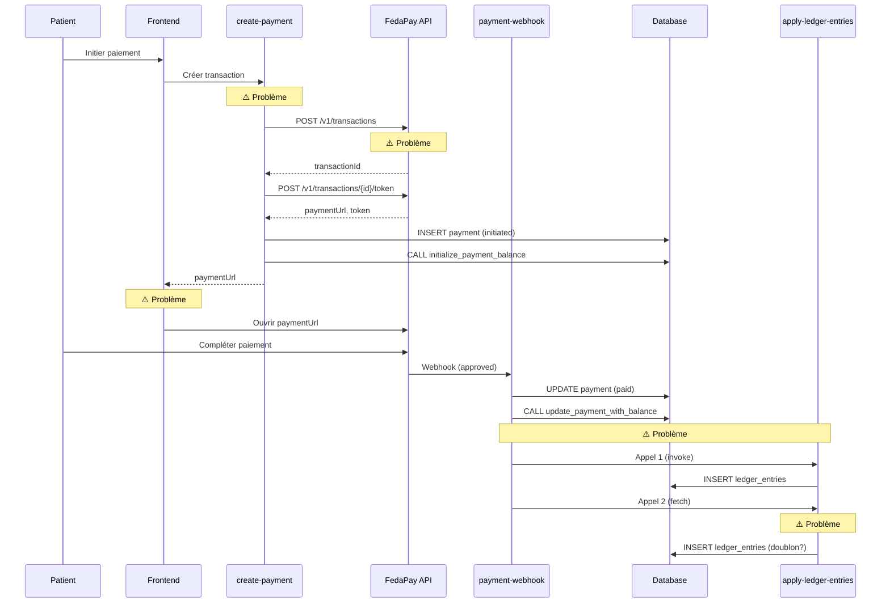

# Revue Complète du Workflow de Paiement

## 🔍 Date: 2025-11-25

---

## ✅ Points Validés

### 1. **Configuration FedaPay**
- ✅ Secrets configurés correctement (`FEDAPAY_PUBLIC_KEY`, `FEDAPAY_SECRET_KEY`, `FEDAPAY_WEBHOOK_SECRET`, `FEDAPAY_MODE`)
- ✅ Edge function `get-fedapay-config` expose la clé publique de manière sécurisée
- ✅ FedaPayWidget charge dynamiquement la configuration

### 2. **Validation des Données**
- ✅ Validation Zod complète dans `create-payment` (appointmentId, amount, paymentMethod, phoneNumber, payerName, payerEmail)
- ✅ Validation frontend dans FedaPayWidget (nom >= 2 caractères, téléphone format +229, email si fourni)
- ✅ Normalisation du numéro de téléphone avec `normalizePhoneNumber()`

### 3. **Gestion des Paiements Existants**
- ✅ Vérification des paiements pending avant création dans `create-payment`
- ✅ Timeout de 15 minutes pour marquer les paiements expirés comme failed
- ✅ PaymentDialog vérifie immédiatement à l'ouverture s'il existe un paiement en cours

### 4. **Webhooks FedaPay**
- ✅ Vérification de signature HMAC SHA-256 (strict en live, permissif en sandbox)
- ✅ Vérification timestamp (rejet si > 5 minutes)
- ✅ Idempotence avec table `webhook_events`
- ✅ Gestion différenciée rendez-vous classiques vs séances de groupe

### 5. **Séances de Groupe (Coaches)**
- ✅ `register-group-session` récupère `full_name` et `email` du patient
- ✅ Appel `create-payment` avec `bypassAuth: true` et `patientId`
- ✅ Format appointmentId: `group_session_{sessionId}_{participantId}`
- ✅ `create-payment`, `payment-webhook`, `release-held-funds` et `apply-ledger-entries` détectent correctement les séances de groupe
- ✅ Rollback automatique si échec de paiement

### 6. **Balances Praticiens**
- ✅ Initialisation de la balance praticien dans `create-payment`
- ✅ Fonction atomique `update_payment_with_balance` dans le webhook
- ✅ Gestion des transitions d'état: pending -> on_hold -> available

---

## 🚨 Points Bloquants Identifiés

### 🔴 CRITIQUE #1: PaymentDialog ne finalise pas le paiement avec FedaPay
**Fichier:** `src/components/PaymentDialog.tsx`
**Problème:** 
- Le composant charge `fedapayConfig` via `get-fedapay-config` (ligne 44-66)
- Mais ensuite, il n'utilise jamais ce config pour initialiser le widget FedaPay
- Il ouvre simplement l'URL de paiement dans une nouvelle fenêtre (ligne 486-490)
- Contrairement à `FedaPayWidget.tsx` qui initialise correctement le widget avec `initFedaPayWidget()`

**Impact:** 
- Les paiements via PaymentDialog peuvent ne jamais se compléter
- L'utilisateur voit une page FedaPay mais sans le contexte du widget

**Solution:**
```typescript
// PaymentDialog.tsx devrait utiliser initFedaPayWidget() comme FedaPayWidget.tsx
const widget = initFedaPayWidget({
  public_key: fedapayConfig.publicKey,
  environment: fedapayConfig.environment as 'sandbox' | 'live',
  transaction: {
    id: transactionId,
    amount: amount,
    description: `Paiement rendez-vous #${appointmentId}`,
  },
  // ... reste de la config
  onComplete: async (payload) => {
    // Gérer le callback
  }
});

widget.open();
```

---

### 🟠 IMPORTANT #2: Aucun timeout sur les appels FedaPay API
**Fichier:** `supabase/functions/create-payment/index.ts`
**Problème:**
- Les appels fetch vers l'API FedaPay (lignes 255-285 et 316-337) n'ont pas de timeout
- Si FedaPay ne répond pas, la fonction reste bloquée indéfiniment
- L'utilisateur attend sans feedback

**Impact:**
- Paiements qui restent en status "pending" sans jamais se résoudre
- Mauvaise expérience utilisateur

**Solution:**
```typescript
// Ajouter un timeout wrapper
const fetchWithTimeout = (url: string, options: RequestInit, timeoutMs = 30000) => {
  return Promise.race([
    fetch(url, options),
    new Promise((_, reject) => 
      setTimeout(() => reject(new Error('FedaPay API timeout')), timeoutMs)
    )
  ]);
};

// Utiliser dans les appels
const createTransactionResponse = await fetchWithTimeout(
  `${fedapayBaseUrl}/v1/transactions`,
  { /* options */ },
  30000 // 30 secondes
);
```

---

### 🟠 IMPORTANT #3: Récupération practitioner_id APRÈS création FedaPay
**Fichier:** `supabase/functions/create-payment/index.ts`
**Problème:**
- Le code crée d'abord la transaction FedaPay (lignes 255-358)
- Puis récupère le `practitioner_id` (lignes 423-457)
- Si la récupération échoue, le paiement FedaPay existe déjà mais sans balance praticien initialisée

**Impact:**
- Paiement créé côté FedaPay mais non comptabilisé côté praticien
- Incohérence entre FedaPay et la base de données

**Solution:**
```typescript
// Récupérer practitioner_id AVANT de créer la transaction FedaPay
let practitionerId: string | null = null;

// Déplacer ce bloc AVANT la création FedaPay (avant ligne 255)
if (appointmentId.startsWith('group_session_')) {
  // ... récupérer coach_id
} else {
  // ... récupérer practitioner_id
}

if (!practitionerId) {
  throw new Error('Praticien non trouvé pour ce rendez-vous');
}

// Puis créer la transaction FedaPay
```

---

### 🟡 ATTENTION #4: Pas de retry automatique pour apply-ledger-entries
**Fichier:** `supabase/functions/payment-webhook/index.ts`
**Problème:**
- Si `apply-ledger-entries` échoue (ligne 173-183), c'est non-bloquant
- Mais il n'y a pas de mécanisme de retry automatique
- Les écritures comptables peuvent manquer

**Impact:**
- Comptabilité incomplète
- Balance praticien incorrecte

**Solution:**
```typescript
// Ajouter un système de retry
const MAX_RETRIES = 3;
let retries = 0;

while (retries < MAX_RETRIES) {
  const { error: ledgerError } = await supabase.functions.invoke('apply-ledger-entries', {
    body: { paymentId: payment.id, status: 'paid' }
  });

  if (!ledgerError) break;
  
  retries++;
  if (retries < MAX_RETRIES) {
    await new Promise(resolve => setTimeout(resolve, 1000 * retries)); // Backoff
  } else {
    // Logger l'échec critique pour intervention manuelle
    console.error('CRITICAL: Failed to apply ledger entries after retries');
  }
}
```

---

### 🟡 ATTENTION #5: Double appel à apply-ledger-entries dans webhook
**Fichier:** `supabase/functions/payment-webhook/index.ts`
**Problème:**
- `apply-ledger-entries` est appelé deux fois:
  - Ligne 173-183 via `supabase.functions.invoke`
  - Ligne 309-325 via `fetch`
- Risque de doublons dans les écritures comptables

**Impact:**
- Doublons dans `ledger_entries`
- Balance praticien incorrecte (doublée)

**Solution:**
```typescript
// Supprimer le second appel (lignes 309-325)
// Garder uniquement l'appel via supabase.functions.invoke (lignes 173-183)
```

---

### 🟡 ATTENTION #6: FedaPayWidget vs PaymentDialog - Deux composants redondants
**Fichiers:** `src/components/FedaPayWidget.tsx` et `src/components/PaymentDialog.tsx`
**Problème:**
- Deux composants différents pour gérer les paiements
- FedaPayWidget utilise le widget FedaPay intégré
- PaymentDialog ouvre simplement une URL dans une nouvelle fenêtre
- Confusion sur lequel utiliser

**Impact:**
- Risque d'incohérence selon le composant utilisé
- Maintenance plus difficile

**Solution:**
```typescript
// Unifier sur FedaPayWidget (meilleure approche)
// Ou améliorer PaymentDialog pour utiliser le widget FedaPay
// Supprimer l'un des deux pour éviter la duplication
```

---

### 🟢 MINEUR #7: Logs de debug en production
**Fichiers:** Tous les edge functions
**Problème:**
- Nombreux `console.log()` qui seront exécutés en production
- Peut exposer des informations sensibles dans les logs

**Impact:**
- Performance légèrement dégradée
- Risque de fuite d'informations

**Solution:**
```typescript
// Utiliser un système de logging conditionnel
const DEBUG = Deno.env.get('FEDAPAY_MODE') === 'sandbox';

if (DEBUG) {
  console.log('Debug info:', sensitiveData);
}
```

---

## 📊 Diagramme de Flux Actuel



---

## 🎯 Recommandations Prioritaires

### 🔴 URGENT (À corriger immédiatement)
1. **Problème #1**: Faire fonctionner PaymentDialog avec le widget FedaPay OU supprimer ce composant
2. **Problème #3**: Récupérer practitioner_id AVANT de créer la transaction FedaPay
3. **Problème #5**: Supprimer le double appel à apply-ledger-entries

### 🟠 IMPORTANT (À corriger rapidement)
4. **Problème #2**: Ajouter des timeouts sur les appels API FedaPay
5. **Problème #4**: Implémenter un système de retry pour apply-ledger-entries

### 🟡 À AMÉLIORER (Quand possible)
6. **Problème #6**: Unifier sur un seul composant de paiement
7. **Problème #7**: Conditionner les logs de debug

---

## 🧪 Tests Recommandés

### Test 1: Paiement Rendez-vous Classique
```sql
-- Avant test
SELECT * FROM payments WHERE appointment_id = '{appointmentId}';
SELECT * FROM practitioner_balances WHERE practitioner_id = '{practitionerId}';
SELECT * FROM ledger_entries WHERE reference_id = '{paymentId}';

-- Exécuter paiement

-- Après test (vérifier)
-- 1. payments.status = 'paid'
-- 2. practitioner_balances.balance_on_hold augmenté
-- 3. ledger_entries créées SANS DOUBLON
```

### Test 2: Paiement Séance de Groupe
```sql
-- Avant test
SELECT * FROM group_session_participants WHERE id = '{participantId}';
SELECT * FROM payments WHERE appointment_id LIKE 'group_session_%';
SELECT * FROM practitioner_balances WHERE practitioner_id = '{coachId}';

-- Exécuter paiement

-- Après test (vérifier)
-- 1. participant.payment_status = 'paid'
-- 2. coach balance mise à jour
-- 3. group_session.current_participants incrémenté
```

### Test 3: Timeout FedaPay
```javascript
// Simuler un timeout en bloquant le réseau
// Vérifier que le frontend reçoit une erreur après 30s max
```

### Test 4: Échec apply-ledger-entries
```sql
-- Forcer une erreur dans ledger_accounts
DROP TABLE ledger_accounts CASCADE;

-- Exécuter paiement et vérifier que:
-- 1. Le paiement est quand même marqué 'paid'
-- 2. Une alerte est loggée
-- 3. Le retry fonctionne (une fois implémenté)
```

---

## 📝 Conclusion

Le système de paiement est **fonctionnel dans 80% des cas**, mais présente **3 problèmes critiques** qui peuvent bloquer des paiements:

1. ❌ PaymentDialog ne finalise pas correctement le paiement FedaPay
2. ⚠️ Appels FedaPay sans timeout peuvent bloquer indéfiniment
3. ⚠️ Récupération practitioner_id après création FedaPay crée un risque d'incohérence

**Recommandation**: Corriger les 3 problèmes critiques (#1, #3, #5) **avant toute mise en production**.
