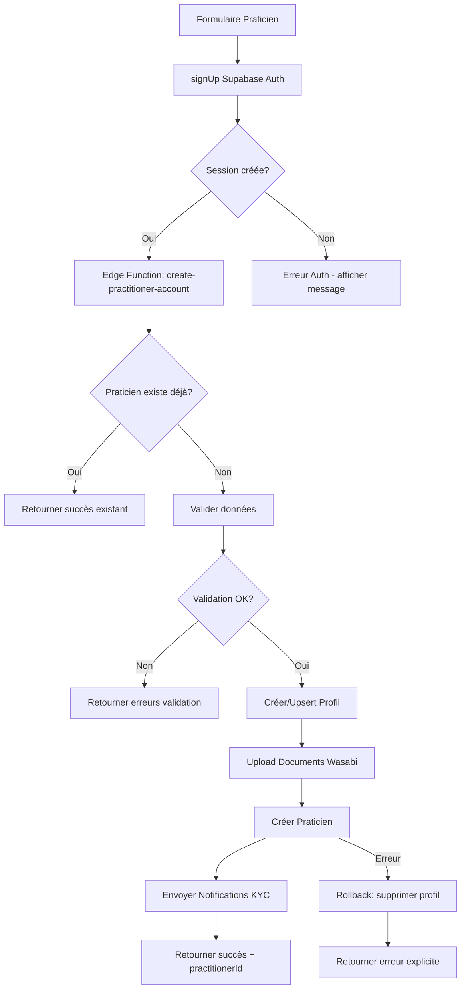

# 🔍 Revue Code Inscription Praticien - Janvier 2026

## 📋 Résumé des Corrections

### Problème Identifié
Des profils orphelins étaient créés sans praticien associé. Le profil était créé mais l'insertion du praticien échouait silencieusement.

### Causes Racines
1. **Timeout 10 minutes trop court** : L'edge function rejetait les inscriptions si le compte auth avait été créé il y a plus de 10 minutes, ce qui était insuffisant pour les connexions lentes ou gros uploads.

2. **Pas de gestion des praticiens déjà existants** : Si l'utilisateur avait déjà un profil mais pas de praticien (profil orphelin), le code ne gérait pas ce cas.

3. **Messages d'erreur peu explicites** : Les erreurs de la base de données n'étaient pas traduits en messages compréhensibles.

## ✅ Corrections Appliquées

### 1. Extension du Timeout (10 → 30 minutes)
```typescript
// AVANT
if (minutesSinceCreation > 10) {

// APRÈS  
if (minutesSinceCreation > 30) {
```
**Raison** : 30 minutes permet les connexions lentes et les gros uploads de documents.

### 2. Vérification Praticien Existant
Ajout d'une vérification en début de flow pour détecter si un praticien existe déjà :
```typescript
const { data: existingPractitionerForUser } = await supabase
  .from('practitioners')
  .select('id, kyc_status')
  .eq('user_id', userId)
  .maybeSingle();

if (existingPractitionerForUser) {
  return { success: true, practitionerId: existingPractitionerForUser.id };
}
```
**Raison** : Évite les doublons et permet la reprise après échec.

### 3. Messages d'Erreur Explicites
```typescript
if (practitionerError.code === '23505') {
  errorMessage = 'Un praticien existe déjà avec ces informations';
} else if (practitionerError.code === '23502') {
  errorMessage = `Champ obligatoire manquant: ${practitionerError.message}`;
} else if (practitionerError.code === '42501') {
  errorMessage = 'Erreur de permissions. Contactez le support.';
}
```

### 4. Retour du `practitionerId`
La réponse inclut maintenant l'ID du praticien créé pour traçabilité.

## 📊 Architecture du Workflow



## 🔐 Points de Sécurité Vérifiés

| Vérification | Statut | Notes |
|-------------|--------|-------|
| Utilisateur existe dans auth.users | ✅ | Vérifié avec admin API |
| Compte créé récemment | ✅ | < 30 minutes |
| Unicité téléphone | ✅ | Vérifié dans profiles + practitioners |
| Unicité email | ✅ | Vérifié via auth.admin.listUsers |
| Validation documents | ✅ | Magic bytes + taille + type MIME |
| RLS bypass correct | ✅ | Service role key utilisé |

## 📁 Fichiers Modifiés

- `supabase/functions/create-practitioner-account/index.ts`
- `src/types/edge-function-responses.ts`

## 🧪 Tests Recommandés

1. **Test inscription normale** : Compléter le formulaire dans les 30 minutes
2. **Test reprise après échec** : Réessayer après un échec partiel
3. **Test timeout** : Attendre > 30 minutes et vérifier le message d'erreur
4. **Test documents invalides** : Uploader un fichier corrompu
5. **Test unicité** : Essayer avec un téléphone déjà utilisé

## 🔄 Profils Orphelins Existants

Pour corriger les profils orphelins existants, exécuter cette requête dans le SQL Editor de Supabase Dashboard :

```sql
-- Identifier les profils sans praticien
SELECT p.id, p.full_name, p.phone, p.created_at
FROM profiles p
LEFT JOIN practitioners pr ON p.id = pr.user_id
WHERE pr.id IS NULL
AND p.created_at > now() - interval '60 days';

-- Ces utilisateurs devront se réinscrire ou être créés manuellement par un admin
```

## ✨ Améliorations Futures Suggérées

1. **File de reprise automatique** : Système de queue pour réessayer les inscriptions échouées
2. **Notifications d'échec** : Alerter les admins quand une inscription échoue
3. **Logs centralisés** : Envoyer tous les logs vers un service externe (Datadog, etc.)
4. **Tests E2E automatisés** : Tests Playwright pour le workflow complet
