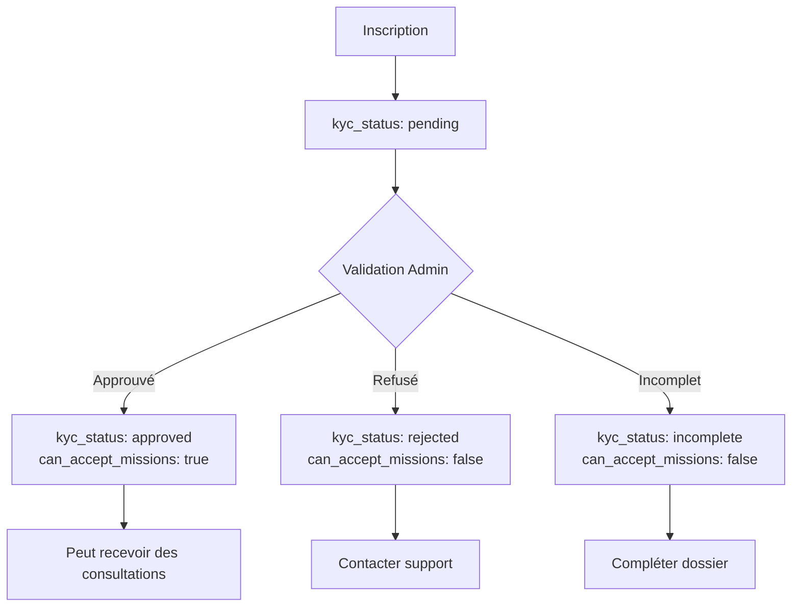

# 🔄 Workflow d'Inscription Corrigé - DomiCares

## ✅ Corrections Appliquées

### 1. **Configuration Auth**
- ✅ Auto-confirmation email activée pour l'environnement actuel
- ✅ Permet une inscription instantanée sans confirmation email
- ✅ Simplifie les tests et le développement

### 2. **Workflow Patient - CORRIGÉ**

#### Avant (Incohérent)
```
1. Création compte Supabase Auth
2. Données onboarding stockées dans metadata
3. Si session existe → créer profil
4. Sinon → données perdues, redirect vers /login
```

#### Après (Cohérent)
```
1. Création compte Supabase Auth (auto-confirmé)
2. Création immédiate du profil complet (completePatientOnboarding)
3. Envoi notification de confirmation
4. Redirection vers /dashboard/patient
5. Utilisateur connecté et profil complet ✓
```

### 3. **Workflow Praticien - CORRIGÉ**

#### Avant (Incohérent)
```
1. Création compte Supabase Auth
2. Création profil + praticien via edge function
3. Déconnexion manuelle de l'utilisateur (!!)
4. Redirection vers / 
5. Praticien existe en DB mais ne peut pas se connecter
```

#### Après (Cohérent)
```
1. Création compte Supabase Auth (auto-confirmé)
2. Création profil + praticien via edge function
   - kyc_status: 'pending'
   - can_accept_missions: false
3. Envoi notification "en attente de vérification"
4. Utilisateur RESTE CONNECTÉ
5. Redirection vers /dashboard/practitioner
6. Affichage alerte "Compte en attente de validation"
```

### 4. **Validation KYC - AMÉLIORÉ**

#### Workflow de Validation Admin
```
1. Admin examine les documents dans KYCQueue
2. Admin approuve/rejette le dossier
3. Mise à jour du statut kyc_status
4. Si approuvé → can_accept_missions: true
5. Envoi automatique d'email/SMS d'activation
6. Praticien peut commencer à recevoir des consultations
```

#### Statuts Praticien Possibles
- **pending** : En attente de vérification (nouveau)
- **approved** : Compte activé, peut recevoir des missions
- **rejected** : Compte refusé (avec raison dans kyc_comment)
- **incomplete** : Documents manquants (avec détails dans kyc_comment)

### 5. **Notifications - HARMONISÉES**

#### Moment d'Envoi des Notifications

**Patient :**
- ✅ Immédiatement après inscription
- Message : "Inscription confirmée, vous pouvez prendre rendez-vous"

**Praticien :**
- ✅ Immédiatement après inscription
- Message : "Dossier en attente de vérification (24-48h)"
- ✅ Lors de la validation du dossier
- Message : "Votre compte est activé ! Vous pouvez recevoir des consultations"

### 6. **Redirections - COHÉRENTES**

| Rôle | Après Inscription | Si Non Connecté |
|------|-------------------|-----------------|
| Patient | `/dashboard/patient` | `/login` |
| Praticien | `/dashboard/practitioner` | `/login` |
| Admin | `/admin` | `/admin-login` |

### 7. **Expérience Utilisateur - AMÉLIORÉE**

#### Patient
```
✅ Inscription → Profil créé → Connecté → Peut prendre RDV immédiatement
```

#### Praticien
```
✅ Inscription → Profil créé → Connecté → Voit alerte "En attente validation"
✅ Validation admin → Reçoit notification → Peut accepter des missions
```

## 📊 Comparaison Avant/Après

### Problèmes Résolus

| Problème | Avant | Après |
|----------|-------|-------|
| **Données perdues** | ❌ Si pas de session | ✅ Toujours créées |
| **Déconnexion forcée** | ❌ Praticien déconnecté | ✅ Reste connecté |
| **Redirections** | ❌ Incohérentes | ✅ Cohérentes |
| **Notifications** | ❌ Moment inapproprié | ✅ Au bon moment |
| **Statut visible** | ❌ Pas d'indication | ✅ Alertes claires |
| **Workflow admin** | ✅ Fonctionnel | ✅ + Notifications auto |

## 🔐 Sécurité

### RLS Policies - Vérifiées
- ✅ Les patients ne peuvent voir que leurs propres données
- ✅ Les praticiens ne peuvent voir que leurs propres données
- ✅ Les admins peuvent gérer tous les utilisateurs
- ✅ Les praticiens "pending" ne peuvent pas accepter de missions

### Validation des Données
- ✅ Validation côté client (formulaires)
- ✅ Validation côté serveur (edge functions)
- ✅ Validation des documents (taille, type, format)
- ✅ Validation KYC manuelle par admin

## 🎯 États Possibles d'un Praticien



## 📱 Notifications par Événement

| Événement | Email | SMS | Destinataire |
|-----------|-------|-----|--------------|
| **Inscription Patient** | ✅ | ✅ | Patient |
| **Inscription Praticien** | ✅ | ✅ | Praticien |
| **Validation Praticien** | ✅ | ✅ | Praticien |
| **Refus Praticien** | ⚠️ | ⚠️ | À implémenter |
| **Dossier Incomplet** | ⚠️ | ⚠️ | À implémenter |

## 🔧 Fichiers Modifiés

### Frontend
- ✅ `src/pages/PatientSignup.tsx` - Workflow simplifié et cohérent
- ✅ `src/pages/PractitionerSignup.tsx` - Suppression déconnexion, redirection cohérente
- ✅ `src/pages/PractitionerDashboard.tsx` - Ajout alertes statut KYC
- ✅ `src/components/admin/KYCQueue.tsx` - Envoi notification activation

### Backend
- ✅ `supabase/functions/send-registration-notification/` - Notifications inscription
- ✅ `supabase/functions/send-account-activation/` - Notification activation compte
- ✅ Configuration Auth - Auto-confirmation activée

## ✨ Prochaines Améliorations Suggérées

1. **Notifications pour statuts "rejected" et "incomplete"**
   - Envoyer email/SMS quand admin rejette ou marque incomplet
   - Inclure les raisons détaillées dans la notification

2. **Dashboard praticien désactivé**
   - Désactiver certaines fonctionnalités tant que kyc_status !== 'approved'
   - Exemple : masquer "Mes consultations" si pending

3. **Rappel automatique validation**
   - Si kyc_status = 'pending' depuis > 48h
   - Notifier les admins automatiquement

4. **Historique des changements de statut**
   - Tracer tous les changements de kyc_status
   - Afficher dans le dashboard praticien

## 🧪 Tests Recommandés

### Scénarios à Tester

1. ✅ **Inscription Patient**
   - Vérifier profil créé
   - Vérifier session active
   - Vérifier redirection vers dashboard
   - Vérifier notification reçue

2. ✅ **Inscription Praticien**
   - Vérifier profil + praticien créés
   - Vérifier kyc_status = 'pending'
   - Vérifier session active
   - Vérifier redirection vers dashboard
   - Vérifier alerte visible
   - Vérifier notification reçue

3. ✅ **Validation Admin**
   - Approuver un praticien
   - Vérifier can_accept_missions = true
   - Vérifier notification activation envoyée
   - Vérifier alerte disparue du dashboard

4. ⚠️ **Rejet Admin**
   - Rejeter un praticien
   - Vérifier alerte d'erreur affichée
   - Implémenter notification de rejet

## 📝 Notes de Migration

Si vous déployez ces changements sur un environnement existant :

1. **Vérifier configuration Auth**
   ```
   Auto-confirm email: ON
   Disable signup: OFF
   ```

2. **Praticiens existants**
   ```sql
   -- Mettre à jour les praticiens sans statut KYC
   UPDATE practitioners 
   SET kyc_status = 'pending' 
   WHERE kyc_status IS NULL;
   ```

3. **Notifications existantes**
   - Les praticiens déjà validés ne recevront pas de notification rétroactive
   - Considérer un envoi manuel si nécessaire

## ✅ Conclusion

Le workflow d'inscription est maintenant :
- ✅ **Cohérent** entre patients et praticiens
- ✅ **Fiable** - pas de perte de données
- ✅ **Transparent** - statuts clairement affichés
- ✅ **Sécurisé** - validation KYC avant missions
- ✅ **Automatisé** - notifications à chaque étape
