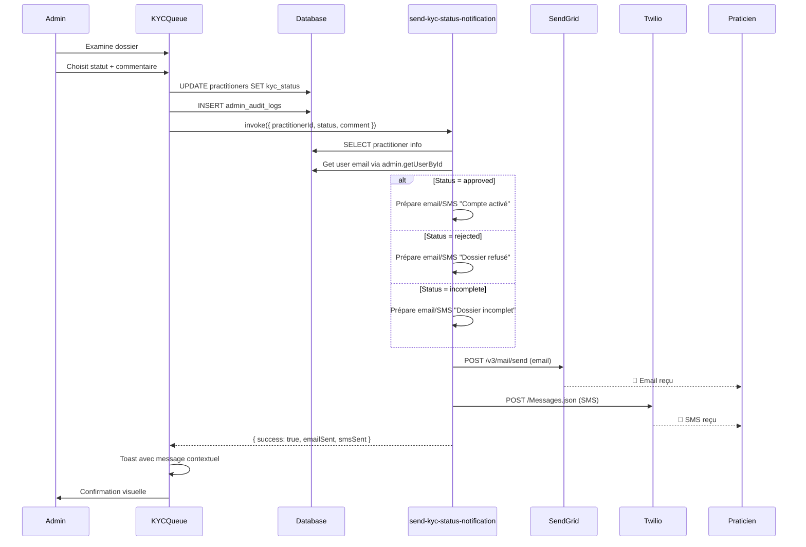

# 📧 Notifications KYC Complètes - DomiCares

## ✅ Étape 4 : Notifications pour Tous les Statuts KYC

### Contexte

Initialement, seul le statut **approved** déclenchait une notification. Les praticiens dont le dossier était **rejected** ou **incomplete** ne recevaient aucune notification, créant une mauvaise expérience utilisateur et des questions de support inutiles.

### Solution Implémentée

Création d'une edge function unifiée `send-kyc-status-notification` qui gère les notifications pour **tous** les statuts KYC avec des messages contextuels adaptés.

## 📁 Fichiers Créés/Modifiés

### Nouvelle Edge Function : `send-kyc-status-notification`

**Emplacement :** `supabase/functions/send-kyc-status-notification/index.ts`

**Responsabilités :**
- ✅ Gère les 3 statuts KYC : `approved`, `rejected`, `incomplete`
- ✅ Récupère les informations du praticien (email, téléphone, nom)
- ✅ Génère des emails HTML personnalisés selon le statut
- ✅ Génère des SMS adaptés avec contrainte de longueur
- ✅ Envoie via SendGrid (email) et Twilio (SMS)
- ✅ Gestion d'erreurs non bloquante

**Interface :**
```typescript
interface NotificationRequest {
  practitionerId: string;
  status: 'approved' | 'rejected' | 'incomplete';
  comment?: string; // Raison du refus ou éléments manquants
}
```

**Exemple d'appel :**
```typescript
await supabase.functions.invoke('send-kyc-status-notification', {
  body: {
    practitionerId: 'uuid-du-praticien',
    status: 'rejected',
    comment: 'Diplôme non valide. Veuillez fournir un diplôme certifié.'
  }
});
```

### Modification : `KYCQueue.tsx`

**Avant :**
```typescript
// Notification uniquement pour 'approved'
if (variables.status === 'approved') {
  await supabase.functions.invoke('send-account-activation', {
    body: { practitionerId: variables.id }
  });
}
```

**Après :**
```typescript
// Notification pour TOUS les statuts
await supabase.functions.invoke('send-kyc-status-notification', {
  body: {
    practitionerId: variables.id,
    status: variables.status,
    comment: variables.comment
  }
});
```

**Avantages :**
- ✅ Une seule fonction pour tous les statuts
- ✅ Commentaire automatiquement inclus
- ✅ Messages toast contextuels selon le statut
- ✅ Code plus simple et maintenable

## 📧 Contenu des Notifications

### 1. Statut : `approved` (Approuvé)

**Email :**
- 🎉 Sujet : "✅ Votre compte DomiCares est activé !"
- Message de félicitations
- Liste des fonctionnalités disponibles :
  - Recevoir et accepter des consultations
  - Gérer sa disponibilité
  - Accéder au dashboard praticien
- Bouton CTA vers le dashboard
- Ton : Positif et encourageant

**SMS :**
```
✅ DomiCares : Votre compte praticien est activé ! 
Vous pouvez maintenant recevoir des consultations. 
Connectez-vous : https://domicares.com/dashboard/practitioner
```

**Design Email :**
- Fond vert clair (#f0fdf4)
- Émojis : 🎉, ✅, 🩺
- Bouton vert (#10b981)
- Structure claire avec sections

### 2. Statut : `rejected` (Refusé)

**Email :**
- ❌ Sujet : "Votre dossier DomiCares nécessite votre attention"
- Message d'explication empathique
- **Encadré rouge** avec la raison du refus (si fournie)
- **Encadré jaune** avec les coordonnées du support
- Ton : Professionnel et bienveillant

**SMS :**
```
❌ DomiCares : Votre dossier n'a pas été validé. 
Raison: [80 premiers caractères du commentaire]...
Contactez le support pour plus d'infos.
```

**Design Email :**
- Fond rouge clair pour la raison (#fef2f2)
- Fond jaune clair pour le support (#fef3c7)
- Émojis : ❌, 📞, 📧, 📱
- Pas de bouton CTA (action support nécessaire)

### 3. Statut : `incomplete` (Incomplet)

**Email :**
- ⚠️ Sujet : "Votre dossier DomiCares est incomplet"
- Message explicatif clair
- **Encadré orange** avec les éléments manquants (si fournis)
- **Encadré bleu** avec les actions à réaliser
- Bouton CTA vers le dashboard pour compléter
- Ton : Constructif et accompagnant

**SMS :**
```
⚠️ DomiCares : Votre dossier est incomplet. 
À compléter: [70 premiers caractères du commentaire]...
Connectez-vous pour finaliser.
```

**Design Email :**
- Fond orange clair pour les manquants (#fffbeb)
- Fond bleu clair pour les actions (#dbeafe)
- Émojis : ⚠️, 📝
- Bouton bleu (#3b82f6)
- Liste à puces des actions

## 🎨 Design Patterns

### Structure Email Commune

```html
<div style="font-family: Arial, sans-serif; max-width: 600px; margin: 0 auto;">
  <h2 style="color: [couleur-statut]">[Titre]</h2>
  <p>Bonjour {fullName},</p>
  <p>[Message principal]</p>
  
  <!-- Encadré contextuel (si commentaire fourni) -->
  <div style="background-color: [bg-color]; padding: 15px; border-radius: 8px; ...">
    <h3>[Titre encadré]</h3>
    <p>{comment}</p>
  </div>

  <!-- Encadré action -->
  <div style="background-color: [bg-color]; padding: 15px; border-radius: 8px; ...">
    <h3>[Action requise]</h3>
    <p>[Instructions]</p>
  </div>

  <!-- CTA (si applicable) -->
  <p>
    <a href="[lien]" style="background-color: [color]; ...">[Texte bouton]</a>
  </p>

  <p style="color: #6b7280; font-size: 14px; margin-top: 30px;">
    Cordialement,<br>L'équipe DomiCares
  </p>
</div>
```

### Palette de Couleurs par Statut

| Statut | Couleur Primaire | Fond Clair | Couleur Texte | Émoji |
|--------|------------------|------------|---------------|-------|
| **approved** | #10b981 (vert) | #f0fdf4 | #065f46 | ✅ 🎉 |
| **rejected** | #ef4444 (rouge) | #fef2f2 | #991b1b | ❌ |
| **incomplete** | #f59e0b (orange) | #fffbeb | #92400e | ⚠️ |

### Contraintes SMS

- **Longueur maximale** : ~160 caractères
- **Commentaire tronqué** : 
  - `rejected` : 80 caractères max
  - `incomplete` : 70 caractères max
- **Ajout "..."** si tronqué
- **Lien court** : Utiliser domaine principal sans sous-chemins

## 🔄 Workflow Complet KYC avec Notifications



## 🔒 Sécurité et Bonnes Pratiques

### ✅ Implémenté

1. **Service Role Key**
   - Edge function utilise le service role pour accéder aux données
   - Bypass RLS pour lire les informations praticien

2. **Validation des Inputs**
   - Vérification que le praticien existe
   - Vérification que l'utilisateur existe
   - Validation du statut (enum)

3. **Gestion des Erreurs Non Bloquante**
   - Échec email n'empêche pas SMS
   - Échec notification n'empêche pas mise à jour DB
   - Logs détaillés pour debugging

4. **Données Sensibles**
   - Pas de données sensibles dans les logs
   - Numéros de téléphone jamais loggés
   - Emails loggés uniquement pour debugging

5. **Rate Limiting Naturel**
   - Une notification par changement de statut
   - Admin ne peut pas spammer (action manuelle)

### 🔐 Considérations

**Commentaires Admin :**
- ⚠️ Commentaires visibles par le praticien
- ✅ Formuler de manière professionnelle
- ✅ Éviter informations confidentielles
- ✅ Rester constructif et actionnable

**Exemple Bon Commentaire :**
```
"Diplôme de kinésithérapeute non lisible. 
Veuillez téléverser une copie certifiée conforme."
```

**Exemple Mauvais Commentaire :**
```
"Diplôme bidon, probablement un faux."
```

## 📊 Métriques et Monitoring

### KPIs Suggérés

**Taux de Délivrance :**
- Email envoyé / Total notifications : >95%
- SMS envoyé / Total notifications : >90%

**Temps de Traitement KYC :**
- Inscription → Approbation : Médiane <24h
- Inscription → Rejet : Médiane <48h
- Incomplete → Rejet/Approbation : Médiane <72h

**Taux de Complétion (Incomplete) :**
- Dossiers incomplets complétés : >70%
- Temps moyen de complétion : <7 jours

### Logs à Analyser

```typescript
// Logs dans la console de l'edge function
'[send-kyc-status-notification] Processing: { practitionerId, status }'
'[send-kyc-status-notification] Email sent successfully'
'[send-kyc-status-notification] SMS sent successfully'
'[send-kyc-status-notification] SendGrid error: ...'
'[send-kyc-status-notification] Twilio error: ...'
```

### Queries Monitoring

```sql
-- Distribution des statuts KYC
SELECT 
  kyc_status,
  COUNT(*) as count,
  ROUND(100.0 * COUNT(*) / SUM(COUNT(*)) OVER (), 2) as percentage
FROM practitioners
GROUP BY kyc_status;

-- Praticiens en attente depuis plus de 48h
SELECT 
  id, 
  name, 
  created_at,
  EXTRACT(EPOCH FROM (NOW() - created_at))/3600 as hours_waiting
FROM practitioners
WHERE kyc_status = 'pending'
  AND created_at < NOW() - INTERVAL '48 hours'
ORDER BY created_at ASC;

-- Historique des changements KYC
SELECT 
  entity_id as practitioner_id,
  action,
  created_at,
  details->>'comment' as comment
FROM admin_audit_logs
WHERE entity_type = 'practitioner'
  AND action LIKE 'KYC%'
ORDER BY created_at DESC
LIMIT 50;

-- Taux de complétion des dossiers incomplets
WITH incomplete_set AS (
  SELECT DISTINCT entity_id
  FROM admin_audit_logs
  WHERE action = 'KYC incomplete'
),
completed AS (
  SELECT DISTINCT entity_id
  FROM admin_audit_logs
  WHERE action IN ('KYC approved', 'KYC rejected')
    AND entity_id IN (SELECT entity_id FROM incomplete_set)
)
SELECT 
  COUNT(DISTINCT incomplete_set.entity_id) as total_incomplete,
  COUNT(DISTINCT completed.entity_id) as completed_count,
  ROUND(100.0 * COUNT(DISTINCT completed.entity_id) / COUNT(DISTINCT incomplete_set.entity_id), 2) as completion_rate
FROM incomplete_set
LEFT JOIN completed ON incomplete_set.entity_id = completed.entity_id;
```

## 🧪 Tests Recommandés

### Test 1 : Approbation avec Notification

```bash
1. Se connecter en tant qu'admin
2. Aller dans KYC Queue
3. Sélectionner un praticien "pending"
4. Cliquer "Approuver"
5. (Optionnel) Ajouter un commentaire
6. Valider

Résultats attendus:
- ✅ Statut passe à "approved"
- ✅ can_accept_missions = true
- ✅ Toast "Le praticien a été notifié de l'activation"
- ✅ Email reçu avec design vert
- ✅ SMS reçu (si téléphone configuré)
- ✅ Dashboard praticien : plus d'alerte pending
```

### Test 2 : Rejet avec Raison

```bash
1. Se connecter en tant qu'admin
2. Aller dans KYC Queue
3. Sélectionner un praticien "pending"
4. Cliquer "Refuser"
5. Remplir commentaire: "Diplôme non valide"
6. Valider

Résultats attendus:
- ✅ Statut passe à "rejected"
- ✅ can_accept_missions = false
- ✅ kyc_comment contient la raison
- ✅ Toast "Le praticien a été notifié du refus"
- ✅ Email reçu avec design rouge + raison affichée
- ✅ SMS reçu avec raison tronquée
- ✅ Dashboard praticien : alerte rouge avec raison
```

### Test 3 : Incomplet avec Instructions

```bash
1. Se connecter en tant qu'admin
2. Aller dans KYC Queue
3. Sélectionner un praticien "pending"
4. Cliquer "Marquer comme incomplet"
5. Remplir commentaire: "Manque: assurance professionnelle, photo d'identité"
6. Valider

Résultats attendus:
- ✅ Statut passe à "incomplete"
- ✅ can_accept_missions = false
- ✅ kyc_comment contient les éléments manquants
- ✅ Toast "Le praticien a été notifié des éléments manquants"
- ✅ Email reçu avec design orange + liste manquants
- ✅ SMS reçu avec liste tronquée
- ✅ Dashboard praticien : alerte orange avec détails
- ✅ Bouton "Compléter mon dossier" visible
```

### Test 4 : Notification sans SendGrid/Twilio

```bash
1. Désactiver SENDGRID_API_KEY (secrets)
2. Répéter Test 1, 2 ou 3

Résultats attendus:
- ✅ Mise à jour DB fonctionne
- ✅ Toast "Statut modifié (erreur d'envoi de notification)"
- ✅ Logs montrent l'erreur
- ✅ Pas de blocage du workflow admin
```

### Test 5 : Commentaire Vide

```bash
1. Approuver/Refuser/Incomplet sans commentaire
2. Valider

Résultats attendus:
- ✅ Email envoyé sans section commentaire
- ✅ SMS envoyé sans raison
- ✅ kyc_comment = null en DB
- ✅ Design email reste cohérent
```

## ✨ Améliorations Futures

### Court Terme

1. **Templates Email Personnalisables**
   - Interface admin pour éditer les templates
   - Variables dynamiques : {name}, {comment}, etc.
   - Prévisualisation avant envoi

2. **Historique des Notifications**
   - Créer table `kyc_notifications`
   - Logger chaque notification (email, SMS)
   - Afficher dans le dashboard admin
   - "Renvoyer notification" si échec

3. **Suivi des Ouvertures Email**
   - Pixel de tracking (SendGrid)
   - Taux d'ouverture par statut
   - Identifier les problèmes de délivrabilité

### Moyen Terme

4. **Notification Multi-Canal**
   - Push notification (si app mobile)
   - WhatsApp Business API (si disponible)
   - In-app notification (dashboard)

5. **Workflow Automatique "Incomplete"**
   - Rappel automatique après 7 jours
   - Escalade vers rejet après 30 jours
   - Email de rappel personnalisé

6. **Dashboard Praticien Amélioré**
   - Checklist interactive pour compléter
   - Upload drag & drop des documents
   - Progression en temps réel (%)

### Long Terme

7. **IA pour Commentaires Suggérés**
   - Analyser les documents manquants
   - Suggérer commentaire pré-rempli
   - Templates de raisons communes

8. **A/B Testing des Messages**
   - Tester différents tons de message
   - Mesurer taux de complétion
   - Optimiser conversion

## 📝 Notes de Déploiement

### Checklist

- [x] Edge function créée et testée
- [x] Modification KYCQueue.tsx
- [ ] Déployer edge function en production
- [ ] Vérifier secrets (SENDGRID_API_KEY, TWILIO_*)
- [ ] Tester email réception (inbox + spam)
- [ ] Tester SMS réception
- [ ] Configurer domaine email (SPF, DKIM)
- [ ] Monitorer logs première semaine
- [ ] Créer alerte si taux échec >10%

### Configuration Production

**SendGrid :**
1. Vérifier domaine email (SPF, DKIM, DMARC)
2. Ajouter email noreply@domicares.com
3. Configurer template branding
4. Activer tracking (ouvertures, clics)

**Twilio :**
1. Vérifier numéro Twilio actif
2. Ajouter crédits suffisants
3. Configurer numéro géographique local
4. Activer reporting (delivery, errors)

### Rollback Plan

Si problème en production :
1. Garder l'ancienne fonction `send-account-activation`
2. Revenir à l'ancien code KYCQueue.tsx
3. Notifications uniquement pour "approved"
4. Investiguer logs edge function
5. Fix et re-déployer

## ✅ Conclusion

Cette implémentation complète le système de notifications KYC :

- 🎯 **Complet** : Tous les statuts KYC notifiés
- 🎨 **Professionnel** : Emails HTML branded et cohérents
- 📱 **Multi-canal** : Email + SMS
- 🔒 **Robuste** : Gestion d'erreurs non bloquante
- 📊 **Monitorable** : Logs et métriques claires
- 🧪 **Testable** : Facile à tester et débugger

Les praticiens sont maintenant **toujours** informés du statut de leur dossier, améliorant drastiquement l'expérience utilisateur et réduisant les demandes de support. 🎉
